# FABRIZIO

### Your Microsoft Fabric assistant

**Fabrizio** is a browser extension that helps you navigate Microsoft Fabric faster by bringing essential tools into a convenient side panel.

Find workspaces and items, access run history, manage your favorites, and simplify repetitive tasks.

  

---

## Demo

https://github.com/user-attachments/assets/76b3f0e4-2ba5-4a09-ab28-cb6334bd7229

  <em>See Fabrizio in action.</em>

---

## Why Fabrizio?

Fabrizio was born as a small independent automation tool to speed up repetitive tasks during my company's migration to Microsoft Fabric (e.g., listing current items in workspaces, viewing history of frequently monitored pipelines and debugging them, ...).
Fabrizio is designed as a **single-tenant assistant**, however it can also support multiple tenants when needed.

## Features

### Favorites
- Save frequently used Fabric workspaces and items.
- Access your favorite resources from a centralized list

### Workspace & Item Search
- Quickly find workspaces and Fabric items (either by name or id)
- Navigate your Fabric environment directly from the side panel.

### Run History
- Inspect available execution history for supported Fabric items.
- Review run details and statuses.
- Navigate directly to job instances.
> The history feature was developed mainly for the DataPipelines (semantic-model refresh or Dataflows were not the main focus)

### Connection Information
- Access Microsoft Fabric connection information.
- Simplify troubleshooting and development workflows.

### Developer Utilities
- Beautify JSON for improved readability of Fabric messages
---

## Installation

Fabrizio is currently distributed as a browser extension project and can be loaded locally in a Chromium-based browser.

1. Clone or download this repository.
2. Open your browser's extensions page.
3. Enable **Developer mode**.
4. Click **Load unpacked**.
5. Select the project directory containing `manifest.json`.
6. Open Microsoft Fabric and launch Fabrizio.

> **Note:** You must be signed in to Microsoft Fabric to use features that require authentication. Access to workspaces and items depends on your account's permissions. Since Fabrizio reads the available cache, it may be needed a first time cache clear action on Fabric tabs, or simply closing and reopening the browser.

## Technology

Fabrizio is built using:

- **JavaScript** — application logic and API interactions
- **HTML** — extension interface
- **CSS** — styling and layout
- **Chrome Extension Manifest V3** — browser extension architecture
- **Microsoft Fabric APIs** — workspace, item, and execution data

## Authentication & Permissions

Fabrizio works within your existing Microsoft Fabric environment and uses the access available to your signed-in account. Fabrizio reads the available cached tokens (per tenant id, if more than one exists) to work.

- Sign in to Microsoft Fabric before using features that require authentication.
- Your existing Microsoft Fabric permissions determine which resources you can access.
- The extension requests browser permissions to support its functionality.

Before installing, review the source code and `manifest.json` to understand the requested permissions and how data is handled.

---

## Project Status

**Fabrizio is no longer actively maintained.**

This project was originally developed to simplify repetitive tasks while working with Microsoft Fabric at my company. However, the company has since disabled browser extensions, meaning I can no longer use Fabrizio in my work environment or continue developing and testing it (especially with multi-tenant solutions).

As a result, **no further updates, bug fixes, or new features are planned in the short run**.

The repository remains public for anyone interested in exploring, using, or adapting the project. Contributions and community-maintained forks are welcome, but I cannot guarantee ongoing support or compatibility with future Microsoft Fabric updates.

## License

This project is licensed under the MIT License.

